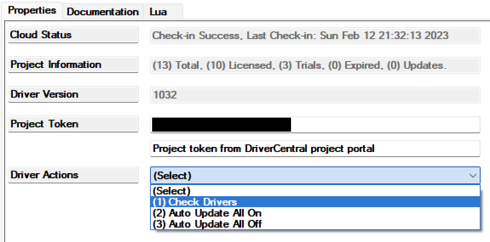

<!-- Copyright 2026 Finite Labs, LLC. All rights reserved. -->

______________________________________________________________________

# Overview

<!-- #ifndef DRIVERCENTRAL -->

> DISCLAIMER: This software is neither affiliated with nor endorsed by either
> Control4 or WLED.

<!-- #endif -->

Integrate [WLED](https://kno.wled.ge) LED controllers into Control4. The driver
connects to a WLED controller on the local network, keeps a live connection to
it, and shows what the controller reports: its name, firmware, MAC address, LED
count and segments.

In this version the driver's light shows whether the controller is online. It
does not turn the LEDs on or off, dim them or change their color yet.

# Index

- [System Requirements](#system-requirements)
- [Features](#features)
- [Compatibility](#compatibility)
- [Installer Setup](#installer-setup)
  <!-- #ifdef DRIVERCENTRAL -->
  - [DriverCentral Cloud Setup](#drivercentral-cloud-setup)
  <!-- #endif -->
  - [Driver Installation](#driver-installation)
  - [Driver Properties](#driver-properties)
  - [Driver Actions](#driver-actions)
  - [Programming Reference](#programming-reference)
  - [Connections](#connections)
  <!-- #ifdef DRIVERCENTRAL -->
- [Developer Information](#developer-information)

<!-- #endif -->

- [Support](#support)
- [Changelog](#changelog)

# System Requirements

- Control4 OS 3.3.2 or later
- A WLED controller running WLED 0.15 or later, on a network the Control4
  controller can reach

# Features

- A live connection to the controller over WLED's WebSocket, so changes made in
  the WLED app, with a button or by another system show at once
- HTTP while the live connection reconnects, so the controller stays reachable
- The controller's name, brand, product, firmware version, MAC address, LED
  count and segments in Composer
- A `Connected` variable and Connected and Disconnected events for programming
- A check that the controller at the address is the one the driver was set up
  with, so it never drives another controller after an address change

# Compatibility

Any controller running WLED 0.15 or later: ESP32, ESP32-S3, ESP32-C3 and ESP8266
boards, whether WLED came installed or was installed by hand.

Each segment reports what its LEDs can light, and the **Segments** property
shows it:

| Shown              | LEDs                                                  |
| ------------------ | ----------------------------------------------------- |
| RGB                | Color, for example WS2812B strips                     |
| RGBW               | Color and a white channel, for example SK6812 strips  |
| RGB, tunable white | Color and two whites, for example RGB+CCT strips      |
| RGB, CCT           | Color, with WLED's white balance correction turned on |
| Tunable white      | Two whites (CCT)                                      |
| White              | One white channel                                     |
| On/off             | A relay                                               |

> **Note:** WLED's own settings change what a segment reports. An RGBW strip
> with WLED's white mode set to calculate the white from the color reports RGB.

# Installer Setup

> ⚠️ Add one **WLED** driver per WLED controller, and give each controller a
> DHCP reservation in the router so its address does not change.

<!-- #ifdef DRIVERCENTRAL -->

## DriverCentral Cloud Setup

> If you already have the
> [DriverCentral Cloud driver](https://drivercentral.io/platforms/control4-drivers/utility/drivercentral-cloud-driver/)
> installed in your project you can continue to
> [Driver Installation](#driver-installation).

This driver relies on the DriverCentral Cloud driver to manage licensing and
automatic updates. If you are new to using DriverCentral you can refer to their
[Cloud Driver](https://help.drivercentral.io/407519-Cloud-Driver) documentation
for setting it up.

<!-- #endif -->

## Driver Installation

<!-- #ifdef DRIVERCENTRAL -->

1. Download the latest `control4-wled.zip` from
   [DriverCentral](https://drivercentral.io/platforms/control4-drivers/lighting/wled).

1. Extract and
   [install](https://www.control4.com/help/c4/software/cpro/dealer-composer-help/content/composerpro_userguide/adding_drivers_manually.htm)
   the `.c4z` file.

1. Use the "Search" tab to find the "WLED" driver and add it to the room the
   LEDs light.

1. Select the newly added driver in the "System Design" tab. The `Cloud Status`
   reflects the license state: `License Activated` if you have purchased a
   license, otherwise `Trial Running` and the remaining trial time.

1. You can refresh the license status by selecting the "DriverCentral Cloud"
   driver in the "System Design" tab and running its "Check Drivers" action.
    

1. Set [`IP Address`](#ip-address) to the WLED controller's address.

1. After a few moments [`Driver Status`](#driver-status-read-only) shows
   `Connected` and the [Device Info](#device-info) properties fill in.

<!-- #else -->

1. Download the latest `control4-wled.zip` from
   [GitHub](https://github.com/finitelabs/control4-wled/releases/latest).

1. Extract and
   [install](https://www.control4.com/help/c4/software/cpro/dealer-composer-help/content/composerpro_userguide/adding_drivers_manually.htm)
   the `.c4z` file.

1. Use the "Search" tab to find the "WLED" driver and add it to the room the
   LEDs light.

1. Set [`IP Address`](#ip-address) to the WLED controller's address.

1. After a few moments [`Driver Status`](#driver-status-read-only) shows
   `Connected` and the [Device Info](#device-info) properties fill in.

<!-- #endif -->

If it does not connect, check the address opens WLED's own page in a browser on
the same network, then set
[`Log Mode`](#log-mode--off--print--log--print-and-log-) to `Print` and check
the Lua output window.

## Driver Properties

### Cloud Settings

<!-- #ifdef DRIVERCENTRAL -->

#### Cloud Status (read-only)

Displays the DriverCentral cloud license status.

<!-- #endif -->

#### Automatic Updates \[ Off | **_On_** \]

Turns automatic driver updates on or off. Changing it on one WLED driver changes
it on all of them.

<!-- #ifndef DRIVERCENTRAL -->

#### Update Channel \[ **_Production_** | Prerelease \]

Production installs releases only; Prerelease also installs test builds.

<!-- #endif -->

### Driver Settings

#### Driver Status (read-only)

Displays the state of the connection:

- `Connected`: the driver has a live connection to the controller.
- `Connected over HTTP; reconnecting live updates`: the live connection dropped
  and the driver reaches the controller over HTTP while it reconnects.
- `Connecting`: the driver is reaching the controller.
- `Not connected: ...`: the controller cannot be reached, and why.
- `Set the IP Address ...`: no address is set.
- `A different WLED controller ... answers at this address`: see
  [Reset Driver](#reset-driver).

#### Driver Version (read-only)

Displays the current version of the driver.

#### Log Level \[ 0 - Fatal | 1 - Error | 2 - Warning | **_3 - Info_** | 4 - Debug | 5 - Trace | 6 - Ultra \]

Sets the logging level. Default is `3 - Info`.

#### Log Mode \[ **_Off_** | Print | Log | Print and Log \]

Sets the logging mode. Default is `Off`. It turns itself off after three hours.

<!-- #ifdef DRIVERCENTRAL -->

#### Support Code

Leave it blank unless Finite Labs support gives you a code: it opens Composer's
Lua tab to this driver for an hour.

#### Cloud Monitoring \[ Disabled | **_Enabled_** \]

When Enabled, the driver sends Finite Labs a short report once an hour, and a
report of each error it hits, at most 10 a minute. We use them to find and fix
problems in the driver. Set it to Disabled to send nothing.

A report holds the controller's MAC address and OS version, the driver's name,
version, device ID and DriverCentral license status, how much memory the driver
uses, and the sizes of its largest internal tables. An error report also holds
the error message and where in the driver it happened. Before a message is sent,
anything in it that looks like a password, token, key, network address or email
address is removed.

The Diagnostics Snapshot action prints a report in the Lua output, and sends it
only while Cloud Monitoring is Enabled.

<!-- #endif -->

### Controller Settings

#### IP Address

The WLED controller's address on the network. Changing it connects to the new
address at once.

#### Port

WLED's web port. Leave it at `80` unless it was changed in WLED.

### Device Info

Read-only details the controller reports, updated whenever they change:
**Name**, **Brand**, **Product**, **Firmware Version**, **MAC Address**, **LED
Count** and **Segments**. **Segments** lists each segment's id, name, LED range
and what its LEDs light (see [Compatibility](#compatibility)).

## Driver Actions

<!-- #ifndef DRIVERCENTRAL -->

### Update Drivers

Checks GitHub for a newer release and installs it.

<!-- #endif -->

### Reset Driver

The driver remembers the MAC address of the first controller it reaches. If a
different controller answers at the address later, for example after the router
gives the address to another device, the driver does not drive it and
`Driver Status` names it. Run Reset Driver with `Yes` when the controller was
replaced on purpose: the driver forgets the old one and takes the controller at
the address.

<!-- #ifdef DRIVERCENTRAL -->

### Diagnostics Snapshot

Prints a diagnostics report in the Lua output, and sends it while Cloud
Monitoring is Enabled.

<!-- #endif -->

## Programming Reference

### Variables

| Variable  | Type | Description                                          |
| --------- | ---- | ---------------------------------------------------- |
| Connected | BOOL | True while the driver is connected to the controller |

### Events

| Event        | When                                                                      |
| ------------ | ------------------------------------------------------------------------- |
| Connected    | The driver connects to the controller, at start and after every reconnect |
| Disconnected | The driver loses the controller                                           |

A live connection that drops while the controller still answers over HTTP fires
neither event.

## Connections

### Light (provider)

The Control4 Light proxy connection. In this version it shows the light online
while the driver is connected and offline while it is not.

<!-- #ifdef DRIVERCENTRAL -->

# Developer Information

Copyright © 2026 Finite Labs LLC

All information contained herein is, and remains the property of Finite Labs LLC
and its suppliers, if any. The intellectual and technical concepts contained
herein are proprietary to Finite Labs LLC and its suppliers and may be covered
by U.S. and Foreign Patents, patents in process, and are protected by trade
secret or copyright law. Dissemination of this information or reproduction of
this material is strictly forbidden unless prior written permission is obtained
from Finite Labs LLC. For the latest information, please visit
https://drivercentral.io/platforms/control4-drivers/lighting/wled

<!-- #endif -->

# Support

<!-- #ifdef DRIVERCENTRAL -->

If you have any questions or issues integrating this driver with Control4 or
WLED, you can contact us at
[driver-support@finitelabs.com](mailto:driver-support@finitelabs.com) or
call/text us at [+1 (949) 371-5805](tel:+19493715805).

<!-- #else -->

If you have any questions or issues integrating this driver with Control4, you
can file an issue on GitHub:

https://github.com/finitelabs/control4-wled/issues/new

<!-- #endif -->

<!-- #embed-changelog -->
